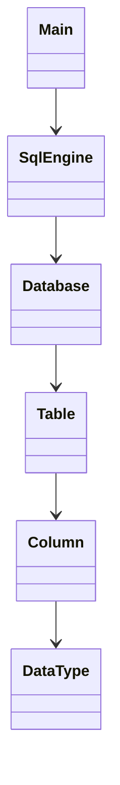
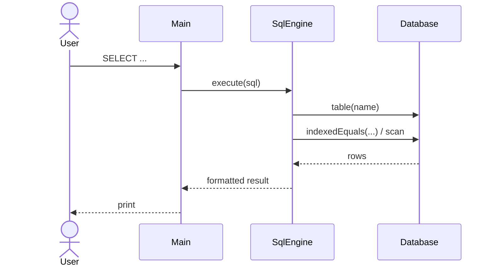

# SimpleDB — упрощённая файловая СУБД на Java

Выполнил: Карымов Андрей 25кнт-6
Учебный проект на Java 8+: таблицы, связи по внешнему ключу, SQL-подобные команды, JSON-хранение и индексы.

## Требования
- JDK 8 или новее
- Maven 3.6+
- Интернет при первой сборке для загрузки Jackson

## Запуск
```bash
mvn clean compile exec:java
```
Команды вводятся в консоль; завершение — `EXIT`.

## Примеры
```sql
CREATE TABLE cars (id INTEGER PRIMARY KEY, brand VARCHAR, model VARCHAR, price DOUBLE, available BOOLEAN, production_date DATE);
CREATE TABLE sales (id INTEGER PRIMARY KEY, car_id INTEGER REFERENCES cars(id), customer VARCHAR, sale_date DATE, amount DOUBLE);
INSERT INTO cars VALUES (1, 'Toyota', 'Camry', 25000.0, TRUE, '2024-01-15');
INSERT INTO cars (id, brand, model, price, available, production_date) VALUES (2, 'BMW', 'X5', 45000.0, TRUE, '2023-05-20');
INSERT INTO sales VALUES (1, 1, 'Ivan', '2024-02-01', 25000.0);
SELECT * FROM cars;
SELECT brand, price FROM cars WHERE price > 20000;
UPDATE cars SET price = 30000 WHERE id = 2;
DELETE FROM cars WHERE brand = 'Toyota';
CREATE INDEX idx_cars_brand ON cars (brand);
SELECT * FROM cars WHERE brand = 'BMW';
DROP TABLE sales;
```

## Поддержка SQL
Реализованы CREATE TABLE, DROP TABLE, CREATE INDEX, INSERT (одна запись), SELECT с одним простым условием WHERE, UPDATE с одним условием, DELETE с одним условием. Поддерживаются `=`, `!=`, `<>`, `>`, `<`, `>=`, `<=`. INSERT с перечнем колонок.

## Архитектура
- `model`: описание схемы, колонок и таблиц.
- `engine.Database`: каталог, ограничения, сериализация JSON, индексы.
- `sql.SqlEngine`: парсинг и выполнение SQL-подобных запросов.
- `Main`: консольный интерфейс.

### Диаграмма классов (упрощённая)


### Диаграмма последовательности SELECT


## Хранение
Таблицы сохраняются в `data/<table>.json`, метаданные индексов — в `data/<table>_<column>.index.json`. При старте файлы загружаются. При выходе данные сохраняются. Запись JSON выполняется напрямую; атомарная замена и журнал транзакций не реализованы.

## Индексация
Используется `TreeMap` (красно-чёрное дерево Java) с отображением значения столбца в номера строк. 

## Тестирование производительности
Для честного отчёта следует провести замеры на целевой машине. Можно измерить `SELECT ... WHERE indexed_column = ...` при разных размерах таблицы, сравнив запуск без `CREATE INDEX` и с индексом. Измерять `System.nanoTime()` после прогрева JVM, выполнять сотни повторов и фиксировать среднее/медианное время. Числа заранее не приводятся, поскольку зависят от оборудования и JVM.


## Источники
- Дейт К. Дж. *Введение в системы баз данных*. — 8-е изд. — М.: Вильямс, 2005.
- Клеппман М. *Высоконагруженные приложения. Программирование, масштабирование, поддержка*. — СПб.: Питер, 2018.
- Гамма Э., Хелм Р., Джонсон Р., Влиссидес Дж. *Приёмы объектно-ориентированного проектирования. Паттерны проектирования*. — СПб.: Питер, 2020.
- Официальная документация Oracle Java SE (пакеты `java.io`, `java.nio.file`, `java.util.TreeMap`, `java.time`). — URL: https://docs.oracle.com/javase/8/docs/api/
